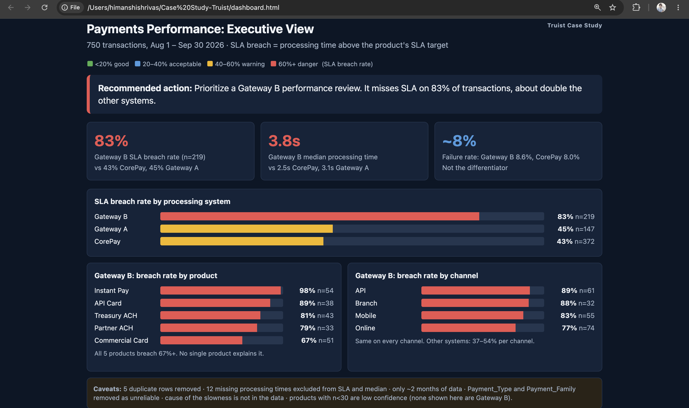

# Case_Study-Truist
Payment transaction data analysis

## Dashboard

## The Problem
Truist's payments run across three processing systems (CorePay, Gateway A, Gateway B). Leadership has no clear view of which system is underperforming against its service-level targets (SLAs).

## The Ask / Leadership Question
**Where is payment processing missing SLA, and what should we do about it?**

## Type of Data
- **payments_transactions.xlsx**: 750 transactions, Aug 1 – Sep 30 2026. Fields: transaction ID and date, product code, payment type, channel, processing system, amount, status, processing time (sec), failure reason, region, customer type.
- **product_reference.xlsx**: product name, payment family, system, SLA target (sec), cost per transaction, category, strategic priority.
- **merged_clean.xlsx**: the two joined and cleaned. SLA breach = processing time above the product's SLA target.

## Data Nonconformities
- 5 duplicate rows removed.
- 12 missing processing times, excluded from SLA and median calculations.
- Payment_Type and Payment_Family removed as unreliable.
- Only ~2 months of data.

## Findings
- **Gateway B misses SLA on 83% of transactions**, vs 43% for CorePay and 45% for Gateway A.
- Median processing time is **3.8s** on Gateway B, vs 2.5s (CorePay) and 3.1s (Gateway A).
- It is slow on **all 5 products (67%+ breach) and all 4 channels (77%+)**, so this is a system problem, not a product or channel problem.
- Failure rates are similar (~8%), so customers see slower service, not more errors.

## Data Governance
- Cleaning steps (deduplication, exclusions, dropped fields) are documented and applied before any metric is calculated.
- Sample sizes (n) are shown on every chart; products with n<30 are flagged low confidence.
- Fields with unreliable values are removed rather than guessed.

## Focus
One story: **Gateway B's SLA performance**. Other cuts (failure rate, product, channel) are used only to test whether something else explains it.

## Final Results
Gateway B is the outlier on SLA, about double the breach rate of the other systems, consistently across products and channels. The data does not show *why* it is slow.

## Recommendations to the Business
1. Open a **performance review of Gateway B**, covering capacity and routing.
2. Track SLA breach rate by system as a standing metric.
3. Extend the data window beyond 2 months and fix Payment_Type / Payment_Family quality at the source.
